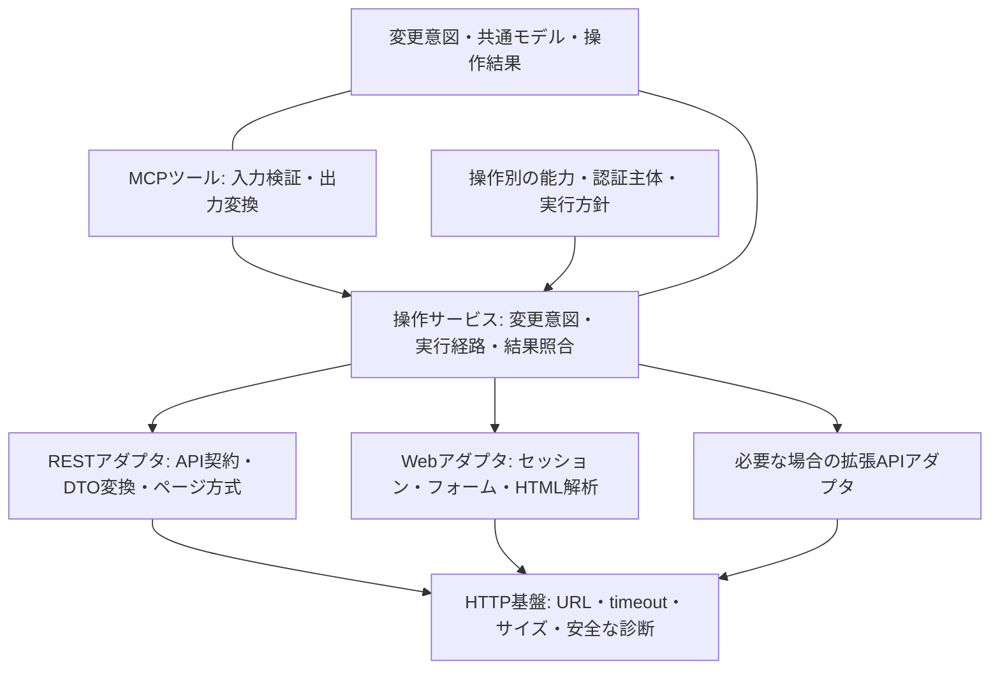

# 修正に向けた設計・アーキテクチャ方針

対象: v0.2.3のレビューと[修正計画](REMEDIATION_PLAN.md)。本書は設計方針であり、実装済みの構成ではない。

## 1. 判断

**設計上の問題はある。個々の条件分岐を修正するだけでは再発しやすいため、境界の見直しが必要。** 一方、stdioのMCPサーバー、Rust/Tokio/reqwest、repository/issue/PR等のドメイン分割、APIをtraitで差し替える構造は維持できる。

以前の修正計画にも、P03の型付き部分更新、P06の能力判定・結果分類、P08〜P10のインライン専用アダプタ、P11のページ分割は含まれていた。ただし、それらをどの層が所有するか、共有型とHTTP形式をどう分けるか、共通HTTPクライアントに何を持たせないかは十分明文化していなかった。本書でその点を補う。

## 2. 現行設計で問題になっている境界

| 現状 | 設計上の問題 | 実際の不具合との関係 |
| --- | --- | --- |
| GitBucketClientがHTTP、資格情報、REST操作、Web起動と救済を持つ | 通信と操作の判断が同居し、各ドメインで救済条件が重複する | 404の誤分類、不要なWeb利用、主体の混在 |
| ツールが作ったUpdate型をそのままPATCH | 利用者の変更意図と、外部APIの入力仕様が同じ型として扱われる | PR本文消失、milestoneの置換、省略と削除の混同 |
| 汎用get_paginatedが全APIの終端を決める | 低い層がエンドポイント固有の契約を仮定する | 25件打切り、非ページング反復 |
| Result<T, GbMcpError>の文字列エラーが中心 | 書込みの適用状態を型として保持できない | 部分適用、保存済みtimeout、未反映200が区別できない |
| API応答型をMCPへ直接公開 | 外部APIの欠落・命名・既定値が利用者向けの意味になる | draft等の欠落、不明値の補作、巨大な一覧 |
| 通常コメントを代表型にする | コメントの保存元・位置・原文形式・IDの違いが表現できない | インラインを取得/投稿できない |
| mockがAPIと同じ前提で成功値を返す | 内部の呼び方が合っているだけで外部互換性を保証したように見える | 実GitBucketと異なるページング・部分更新を見逃す |

構造の複雑さ自体より、**外部APIの都合を、操作の意味やMCP仕様と同一視していること**が中心的な問題。

## 3. 目標とする責務分担



図のHTTP基盤は共通の設定・ヘルパーを指す。RESTとWebの認証付きreqwest Clientを1個へ統合する意味ではない。PATヘッダーとWeb cookieは分離し、同じURL構築・時間予算・サイズ制御・サニタイズ方針を適用する。

### A. MCPツール

所有するもの: 引数schema、未知引数拒否、利用者向けの入力検証、MCPの成功/エラーへの変換。

RESTへの現在値補完、404救済、signin、HTML解析、書込み再試行は持たない。通常コメントとインラインコメントは別の操作として公開する。

### B. 操作サービス

所有するもの: 「何を変更したいか」の解釈、現在値取得、適用前検証、能力に応じた実行経路、変更後照合、部分適用/不明結果、実行主体とread-onlyの制約。

配置は`src/api/`内の操作調整モジュールを基本とする。最初はPR/milestoneの更新から抽出し、必要な範囲だけ増やす。名称例は`workflows`や`service`。tools層に業務判断を逆流させない。

### C. REST / Web / 拡張APIアダプタ

RESTはエンドポイントごとのリクエスト/レスポンス形式、ページ方式、外部型から共通型への変換を扱う。Webはフォーム、HTML、ログイン状態、Web側の成否を扱う。どちらも自分の失敗を理由に他アダプタの書込みを勝手に実行しない。

拡張APIはP08で必要性が実証された場合だけ追加する。Web方式と拡張API方式を切り替えても、コメントの意味や公開ツールを変更せずに済む境界にする。

### D. HTTP基盤

URLの安全な構築、timeout、サイズ制限、レスポンス読取り、安全な診断を担当する。100件というページ上限、milestoneのtitle補完、404時のWeb切替、アプリケーションとしての成功判定は担当しない。

## 4. 型と契約の方針

### 4.1 変更意図とHTTP形式を分ける

共有モデルを`src/models/`に置き、利用者の変更要求と、GitBucketへ送るDTOを明確に分ける。MCPのParams、共通の変更意図、REST DTOを同一の構造体で兼用しない。

内部の部分更新は、概念として次の3状態を表せる型にする。

```rust
enum FieldChange<T> {
    Keep,
    Set(T),
    Clear,
}
```

title等のクリア不可フィールドにはClearを許さない型/検証を使う。本文の空文字、JSON null、入力省略を境界で明確に変換する。Optionを何重にも重ねて意味を推測させない。

例: milestoneのstateだけ変更する要求はKeep/Setとして受け、操作サービスが現在値を取得し、RESTアダプタへ完全なtitle/state/description/due_onを渡す。Webを選ぶ場合も同じ変更意図を使う。

### 4.2 通信結果と操作結果を分ける

通信レベルのtimeout/HTTP status/JSON解析失敗と、操作レベルの未適用/確認済み適用/部分適用/結果不明/競合/未対応を分離する。

- GET失敗は通常の読取り失敗として返せる。
- POST送信後の切断は、保存されなかったと断定できない。
- PATCHのHTTP 200でも要求値と違えば確認済み成功ではない。
- 複数項目のうち一部が適用された場合は、その事実を失わない。

これらをMCPのis_errorや文字列へ変換するのはtools/responseの責務。API層がrmcp型を返す設計にはしない。P01等の緊急修正で導入する最小エラーも、後で同じ結果型へ収束させる。

### 4.3 能力は操作単位・根拠付き

「このGitBucketはREST対応」という一括フラグにしない。PR本文更新、label改名、label同名色変更、milestone日本語title、インライン原文取得等を必要な粒度で管理する。

能力、Web資格情報の有無、認可、今回の要求を表現できるかは別項目。資格情報があるだけでWebへ進めない。版情報は根拠の一つであり、未知の404で能力を確定しない。未確認/非対応/今回権限なしを区別する。

能力確認のための書込みを自動実行しない。未知環境向けの設定を設ける場合も、操作範囲を限定し、根拠と診断を残す。

### 4.4 コメントの種類・ID・位置・本文形式を保持する

通常のIssueCommentとCommitComment/ReviewCommentを分ける。IDは保存元の種類と組み合わせて扱い、異なる保存元の同じ数値を同一コメントと見なさない。

元のcommit/位置と現在のcommit/位置を別に保持する。本文原文とレンダリング済みHTMLも区別する。取得不能な位置や原文を推測して埋めない。GitBucketに存在しない返信/解決状態を架空のスレッドAPIで表現しない。

### 4.5 RESTのページとMCPのページを分ける

RESTアダプタはGitBucketからどう取得するかを決め、操作サービスは必要件数・取得完全性を扱い、MCPは利用者へどの範囲を返すかを定義する。

25件のRESTページと50件のMCP応答は両立できる。非ページングAPIのMCP応答分割も可能だが、GitBucketからの全件読取りまで省略できるわけではない。サイズ超過や更新中の一覧の整合性限界も表示する。

## 5. 横断的な方針

### 認証とセッション

認証主体の確認は操作サービス/認証コンテキスト、cookieや有効期限はWebアダプタが扱う。まず必要時のセッション確立で正しさを確保する。セッション再利用は期限・排他・主体確認を検証してから追加する。

セッション切れを理由に書込みを自動再送しない。読取りによる事前確認やログイン更新と、投稿の再実行は分ける。WebとPATの主体が異なる操作は既定で拒否する。

### 競合とトランザクション

GET→補完→PATCHやWebの多段更新は、外部利用者を含めた原子的処理ではない。プロセス内mutexを入れてもこの限界は解決しない。

可能な事前照合・事後照合と部分適用の明示を行い、厳密な条件付きマージ等が必要ならAPI側の保証を要求する。外部APIが提供しないトランザクションやexactly-onceをクライアントだけで約束しない。

### traitとテストの境界

既存GitBucketApiはMCPが依存する操作用の窓口として活用できるが、現在のHTTPクライアントの全責務をそのまま固定するインターフェースとは見なさない。

最初から全ドメインのtraitを細分化しない。公開コンストラクタ/with_apiの移行方法を保ち、操作サービスを窓口の実装として段階導入する。HTTP DTOを窓口の引数へ露出させない。traitが大きくなりテストの差替えが困難になったドメインから分割する。

テストは、変更意図→実行経路→結果照合のサービス検証、REST/Webの実契約検証、MCP入出力検証を分ける。P00の実GitBucket fixtureを契約の根拠にし、サービスのmock成功だけでHTTP互換性の証拠としない。

## 6. 既存計画への組込みと移行順序

| 段階 | 導入する設計 | 対応作業 |
| --- | --- | --- |
| 実装前 | 層の責務、変更意図/DTO、結果型、互換性方針を確定 | P00、本書 |
| 緊急修正 | PR/milestoneの変更意図と現在値補完を小さく分離。ページ方式を個別APIへ戻す | P01/P02/P03 |
| 基盤改善 | REST/Webの共通通信方針と認証の分離 | P04/P05 |
| 互換性整理 | 操作サービスが経路と結果を管理し、各APIの重複フォールバックを移す | P06/P07 |
| インライン対応 | 専用モデルとWeb/拡張APIアダプタを既存窓口に接続 | P08/P09/P10 |
| 応答・運用 | ページ付き出力、能力に基づくマージ、設定とCIを整備 | P11〜P14 |

先に巨大な抽象層を完成させる工程は設けない。最初のPR更新修正を使って境界の妥当性を確認し、同じ方針をmilestoneへ適用する。構造の移動だけの変更と意味の修正は、差分が追える単位に分ける。

## 7. 設計変更の完了条件

- toolsのコードにREST/Web選択、HTML、更新補完がない。
- HTTP基盤に全API共通のページ件数やWeb救済条件がない。
- REST/Webを切り替えても変更意図が変わらず、表現できない要求を操作前に検出できる。
- 未適用/一部適用/結果不明がMCP変換まで失われない。
- コメントの種類・原文/HTML・現在/元位置を区別できる。
- 既存ツールの互換性変更と外部APIに起因する保証の限界が文書化される。
- RESTのみの環境でも対応操作を使え、Web資格情報の有無が無関係な機能を壊さない。
- 回帰テストが実GitBucket契約と対応し、同じ不具合をmockの作り方で隠さない。
