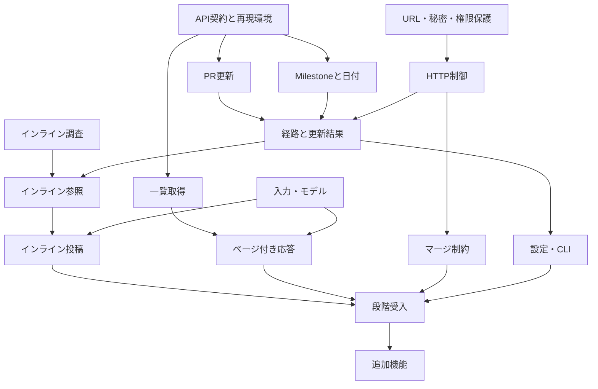

# GitBucket MCP Server 修正計画

作成日: 2026-11-01。対象: v0.2.3 / `00e364a079fb275a51f4ed30fc0dc852d26a23f6`。

根拠: [REVIEW.md](REVIEW.md)のF01〜F30と「Webフォールバックを本当に必要とする操作」。本書の作業定義は計画であり、実施状態は次の進捗欄で管理する。従来の[PLAN.md](PLAN.md)は開発履歴として残し、今回の修正の順序・完了条件は本書を正とする。

## 実施状況（2026-11-21）

| 作業 | 状態・証拠 |
| --- | --- |
| P00 | PR更新・一覧・milestone部分更新・label色更新の契約確認を実施。公式Docker 4.44.0/4.48.0で各対象のE2Eを検証。P06aでは上流ソースと実版で同名label更新422・description非提供を確認 |
| P01 | [PR #20](https://github.com/Masahiro-Obuchi/gitbucket-mcp-server-rs/pull/20)はマージ済み（main `4b8ab6a`）。タイトル/本文の独立更新・保持、原文保持、base事前検証、応答照合、結果不明の分類を実装。能力別の振分けはP06で対応 |
| P02 | [PR #21](https://github.com/Masahiro-Obuchi/gitbucket-mcp-server-rs/pull/21)はマージ済み（main `98b2e6f`）。Issue/PRを25件ページで空ページまで取得し、非ページング一覧は1回取得へ変更。重複ID、途中失敗、100要求上限では部分結果を成功にしない。通常テスト224件と両CI、両版の一覧E2E各6件が成功 |
| P03 | [PR #22](https://github.com/Masahiro-Obuchi/gitbucket-mcp-server-rs/pull/22)はマージ済み（main `61e61bf`）。milestone省略項目とclosed状態の保持、日付の型・事前検証、PAT単独更新、応答照合、Web経由の日時欠落防止を実装。通常テスト244件、両CI、4.44.0/4.48.0のmilestone E2E各3件が成功 |
| P04 | [PR #23](https://github.com/Masahiro-Obuchi/gitbucket-mcp-server-rs/pull/23)はマージ済み（main `517f3db`）。REST/Web共通の安全なURL構築、識別子・base URL検証、redirect境界、Debug/診断の秘密保護、0600原子的保存・symlink保護、E2E権限・quoting・CI形式分離・localhost制限を実装 |
| P05 | [PR #24](https://github.com/Masahiro-Obuchi/gitbucket-mcp-server-rs/pull/24)はマージ済み（main `d97847b`）。共有HTTP時間・応答サイズ制限、MCP処理予算、キャンセル、書込み追跡と結果不明の分類、再送無効化を実装 |
| P06a | [PR #25](https://github.com/Masahiro-Obuchi/gitbucket-mcp-server-rs/pull/25)はマージ済み（main `70c0421`）。共通standard契約とrest-onlyに整理し、legacy-404・バージョン別設定・404起点の補助書込みを削除。`GITBUCKET_API_PROFILE`で上流契約を選択する。label description入力を型・スキーマから除去し未知引数を拒否。PR専用エラー型・旧Issue段階型を削除して共通結果型へ統一 |
| P06a検証 | 簡素化後に通常テスト279件、Python 7件、bash構文、fmt、clippy、GitHub Actionsのpush/PR両CIが成功。共通standard設定で公式4.44.0/4.48.0の全22件のE2Eが各版で成功。削除した旧経路専用テストを整理し、現在の入力拒否・404非救済・反映確認・不明結果の検証を残した |
| P06b | [PR #26](https://github.com/Masahiro-Obuchi/gitbucket-mcp-server-rs/pull/26)はマージ済み（main `a27c409`）。追加されたform action解決・認証名を含むrepo/contextの扱い・label target事前検証と構築例修正も次の基点へ反映。PAT・設定username・Cookie単独の実ユーザー照合と各更新前の再確認を必須化。Web自動redirectと307/308再送を禁止し、操作固有の読取り先だけ追従。Jetty URL session IDを除去しCookieのみ使用。HTML解析を専用モジュールへ集約しlabelの完全一致・曖昧性を検証。Issue反映照合、label/milestone削除後404照合、更新前auth失敗と更新後unknownの区別を実装。旧独立signin・未使用Web削除等を除去 |
| P06b検証 | 通常テスト292件、Python 7件、bash構文、fmt、clippyが成功。公式Docker 4.44.0/4.48.0の全22 E2Eが各版で成功。GitHub Actionsのpush/PR両CIも成功。検証コンテナ・ボリューム・一時資格情報は削除済み |
| P06c | [PR #27](https://github.com/Masahiro-Obuchi/gitbucket-mcp-server-rs/pull/27)はマージ済み（main `d64a754`、レビュー後head `e01aa8b`）。共有OperationOutcome/Target・項目状態・要求/保持intentを導入。操作サービスが照合、HTTPが実送信/拒否、MCPが結果出力を所有。組込み書込みの対象・経路、部分適用/不明/未反映/確定拒否、安全な原因を構造化。期限切れ/キャンセルでも途中の観測を保持。Issueサービスを分離し、Web milestoneは内容照合後に状態更新。PR応答IDを確認し、曖昧なmilestone作成は候補IDを返す。旧2エラーvariant・旧kindを互換aliasなしで削除 |
| P06c検証 | 通常テスト303件、Python 7件、bash構文、fmt、clippyが成功。公式Docker 4.44.0/4.48.0の全22 E2Eが各版で成功。GitHub Actionsのpush/PR両CIも成功。検証コンテナ・ボリューム・一時資格情報は削除済み |
| P07 | [PR #28](https://github.com/Masahiro-Obuchi/gitbucket-mcp-server-rs/pull/28)はマージ済み（main `75536dd`、head `bcb6b1b`）。全29ツールの未知引数を拒否し、Markdown等の原文を保持。Web Issueの保持不能な本文変更は他の書込み前に拒否。PR/Issueのメタデータを公式ソース由来fixtureに沿って保持し、閉鎖日時の推定・欠落値の空配列/false補完を廃止。全ツールの注釈と、注釈から独立した閲覧専用設定・登録制限・直接ハンドラーの書込み拒否を追加。破壊的な入力/公開Rust型の変更を文書化 |
| P07検証 | 通常テスト319件、Python 7件、bash構文、fmt、clippyが成功。全29ツールの未知引数でHTTP未送信、全15変更ツールのMCP/直接呼出し拒否を確認。公式Docker 4.44.0/4.48.0の全23 E2Eが各版で成功。fork欠落/明示の版差を生API応答と照合。検証コンテナ・ボリューム・一時資格情報は削除済み。GitHub Actionsの[push CI](https://github.com/Masahiro-Obuchi/gitbucket-mcp-server-rs/actions/runs/41850220472)・[PR CI](https://github.com/Masahiro-Obuchi/gitbucket-mcp-server-rs/actions/runs/41850333295)がともに成功 |
| P08 | [PR #29](https://github.com/Masahiro-Obuchi/gitbucket-mcp-server-rs/pull/29)はマージ済み（main `5911582`、レビュー後head `b959fff`）。公式2版のソースと使い捨て環境を調査。`docs/inline-comment-design.md`、再現ハーネス、Git blob/Docker digest付き実応答fixtureを追加。GUESTの他者原文取得401、Web投稿trim、不正位置の受理、head位置移動/履歴置換後の欠落、折りたたみ、同一数値IDの別保存元の会話欠落を確認。Webの範囲付き取得/制約付き投稿と、原文・全履歴・原子的head保証に必要な拡張経路の最小契約、P09/P10の受入条件を分けて設計。追加レビューでfileNameのtrim制約と前後空白付きGitパスの事前拒否条件も文書化。新MCPツール・API拡張の実装は含めない |
| P08検証 | 通常Rustテスト319件、Python13件（新規契約6件+runtime7件）、fmt、clippy、bash構文、文書リンク・再現コマンド構文、diffチェックが成功。公式Docker 4.44.0/4.48.0の各版で11種類のコメント・GUEST権限・head追加/履歴置換・マージ後までライブprobe完了。専用コンテナ・ボリューム・一時資格情報を削除済み。[push CI](https://github.com/Masahiro-Obuchi/gitbucket-mcp-server-rs/actions/runs/41868748400)・[PR CI](https://github.com/Masahiro-Obuchi/gitbucket-mcp-server-rs/actions/runs/41868839198)がともに成功 |
| P09 | [PR #30](https://github.com/Masahiro-Obuchi/gitbucket-mcp-server-rs/pull/30)はマージ済み（main `ba7d562`、head `ee4c200`）。専用レビュー型、list/getツール、操作サービス・Web読取り・厳密DOM解析を追加。standardと同一主体PAT/Web資格情報を要求し、rest-onlyはHTTP前に拒否。`commit:<ID>`、HTML/原文区別、不明な元位置/日時、未検証の位置/保存関連、全履歴ではないcoverageを出力。単一取得の未観測はnull/statusで表し、削除・全保存元での不存在と断定しない。前後のPR変更はread_conflict、構造異常・権限・サイズ・期限等は空成功にしない。本文の疑似メタデータを分離。31ツール中16読取りを閲覧専用へ登録。公開trait2メソッド/エラーvariantの変更を文書化。インライン投稿・拡張APIは未追加 |
| P09検証 | 通常Rust333件、Python13件、fmt/clippy・bash構文・文書リンク・diffが成功。公式4.44.0/4.48.0で各版の所有者/GUEST×初期/head追加/履歴置換/マージ後の8組を実stdio MCPで照合し、ID/種類/本文/著者/位置と未観測を確認（11→11→6→6件）。既存23 E2Eも各版で成功。最終の本文分離補強後に両版stdio照合を再確認。専用コンテナ・ボリューム・資格情報・MCP子プロセスを削除/終了済み。[push CI](https://github.com/Masahiro-Obuchi/gitbucket-mcp-server-rs/actions/runs/42073450331)・[PR CI](https://github.com/Masahiro-Obuchi/gitbucket-mcp-server-rs/actions/runs/42073641214)がともに成功 |
| P10 | [PR #31](https://github.com/Masahiro-Obuchi/gitbucket-mcp-server-rs/pull/31)はマージ済み（main `b845d34`、head `e006a52`）。専用addツールを追加し、open PRの現行head・base/head固定patch・正確なpath/旧新変更行を検証。明示必須head_guardはpreflightのみ、atomic・保持不能な前後空白/制御文字はHTTP前に拒否。native POSTを1回だけ行い、新規ID・本人の保存原文・commit位置・PR会話観測・投稿後head/base/stateを照合。失敗/切断/期限切れで対象と捕捉IDを保持し、自動再投稿・通常コメント代替・巻戻し削除を行わない。32ツール中16読取り、全16変更を閲覧専用で拒否。保存元PR関連・完全履歴・原子的head保証は非対応。追加/変更された通常テキストファイルの変更行に限定。公開Rust型/trait変更と対応範囲を文書化 |
| P10検証 | 通常Rust345件、投稿回帰8件（通常345件に含む）、Python13件、fmt/clippy・bash構文・文書リンク・diffが成功。公式4.44.0/4.48.0の各版で実stdio MCP投稿3件（owner新行/GUEST旧行/日本語・引用符付き追加ファイル）、入力拒否8件、閲覧専用拒否、通常会話コメント不変を確認。各版でowner/GUEST×4時点の参照8組（14→14→8→8件）と既存23 E2Eが成功。専用コンテナ・ボリューム・一時資格情報・MCPプロセスを削除/終了済み。[push CI](https://github.com/Masahiro-Obuchi/gitbucket-mcp-server-rs/actions/runs/42234981239)・[PR CI](https://github.com/Masahiro-Obuchi/gitbucket-mcp-server-rs/actions/runs/42235099864)がともに成功 |
| P11 | [PR #32](https://github.com/Masahiro-Obuchi/gitbucket-mcp-server-rs/pull/32)はマージ済み（main `7c3ac18`、head `7f32790`）。全8一覧にlimit（既定50/最大100）・cursor・view（summary/full）を追加。配列キーを維持し、has_more/next_cursor/rangeで件数・取得範囲・観測総数・source_complete・非原子的な整合性・制限理由を出力。summaryは本文/繰返しrepo詳細を省略し、UTF-8 1024バイト/入れ子配列20件への切詰めを項目metadataで明示。64 KiBのCallToolResult上限には構造化/テキストの両表現を含める。cursorは対象/番号/filters/view/limitと発行済み位置に結合し、5分・16観測/8 MiBのキャッシュから継続、観測は10000件/2 MiBで制限。上流の初回取得契約は維持し、継続時はHTTPなし。sourceは非原子的、レビューcoverageは最終ページでも部分。APIのVec/詳細getは維持し、未使用の無制限success_listを削除。公開Params変更・full指定・継続と期限切れ・権限再照合なしの制約を文書化 |
| P11検証 | 通常Rust358件、Python13件、fmt/clippy・bash構文・文書リンク・diffが成功。新規REST/MCP10件・Web継続1件・キャッシュ単体2件で境界/全ID/上流変更/cursor条件・未発行位置拒否/巨大本文/日本語/未知値/表示省略・切詰め/バイト上限/期限切れ・eviction/途中失敗を確認。公式4.44.0/4.48.0で各版23 E2E成功。大量一覧を実cursor走査へ変更し、巨大日本語本文のsummary省略/detail保持/full上限を照合。両版のowner/GUEST×4時点の参照8組とP10投稿3件/拒否8件/閲覧専用拒否も成功。専用コンテナ・ボリューム・資格情報・MCPプロセスを削除/終了済み。[push CI](https://github.com/Masahiro-Obuchi/gitbucket-mcp-server-rs/actions/runs/42380303178)・[PR CI](https://github.com/Masahiro-Obuchi/gitbucket-mcp-server-rs/actions/runs/42380372538)がともに成功 |
| P12 | [PR #33](https://github.com/Masahiro-Obuchi/gitbucket-mcp-server-rs/pull/33)はマージ済み（main `75041f0`、head `f948fb3`）。merge/squash/rebaseを公開し、mergeはnative merge-commitへ変換。通常noneと明示的preflight expected_head_shaを分け、効かないshaを送らずatomicはHTTP前に非対応。open/未merge/draft=false・revision・base tip・最終PR一致後に1回PUT。PR closed/merged・結果commit/親・base tipを独立照合。4.44 ObjectId/4.48 MergeResult文字列表現を厳密に正規化。nullable mergeableをtrue化せず、設定拒否を他戦略で救済しない。rebaseの無視されるmessageは事前拒否。結果はrequested_merge_methodと検証範囲を返し、atomic/全文message/完全rebase同値性/設定事前照合を主張しない。エラー・切断・期限切れでPR/base/観測head/捕捉result_commitを保持し、保持headだけで部分適用にせず再送/巻戻しなし。PATのみで利用でき、公開Rust型/移行/契約を文書化 |
| P12検証 | 通常Rust367件、Python16件、fmt/clippy・bash構文・文書リンク・diffが成功。最終の保持head intent分類/空native List補強後にも専用HTTP/MCP8件＋厳密解析1件が成功。3戦略・draft/不明draft・null mergeable・head競合・sha無視・405設定拒否・異常応答/実TCP切断・期限切れ・ID保持・非再送・閲覧専用/旧引数拒否を確認。公式4.44.0/4.48.0で各版3戦略の実stdio/Git親ID・commit数・message suffix・slash branchと8拒否、native誤sha無視・応答形式を照合。既存23 E2E、owner/GUEST×4時点の参照8組、P10投稿3件/拒否8件も両版成功。専用コンテナ・ボリューム・資格情報・MCPプロセスを削除/終了済み。[push CI](https://github.com/Masahiro-Obuchi/gitbucket-mcp-server-rs/actions/runs/42469824295)・[PR CI](https://github.com/Masahiro-Obuchi/gitbucket-mcp-server-rs/actions/runs/42469898931)がともに成功 |
| P13 | [PR #34](https://github.com/Masahiro-Obuchi/gitbucket-mcp-server-rs/pull/34)はマージ済み（main `cd5d554`、head `974c8f8`）。完全URL/token envではconfigパス/TOMLを読まず、部分envは不足値をファイルから解決。空値/不正UTF-8はfallbackせず拒否し、Web資格情報は常にenv-onlyでペア検証。Config::from_envを削除し0600保存・symlink対策を維持。設定/ログ/runtimeより前にhelp/version、HTTPなしcheck-configとPAT本人GETのみcheck-connectionを追加。診断は秘密/本人名/非公開URLを出力せずWebパスワード未送信。待機とMCP initialize/initialized後readyを区別。既存lockの最大依存要件に合わせRust1.88を宣言しLinux最小版build/checkとstableのlocked CIを整合。REST/WebをRustls native rootsへ明示統一し、CA override・PAT/Web利用範囲・移行・起動手順を関連文書と同梱Skillへ反映。production依存の版更新なし |
| P13検証 | 通常Rust381件（新規config4件+CLI実プロセス10件を含む）、Python16件、fmt/clippy・bash構文・文書リンク・diffが成功。Rust1.88.0でlocked build/all-targets/all-features check成功、1.86は既存依存要件により拒否を確認。ローカルTLSで未信頼拒否と明示CAによる診断・REST書込み・Web cookie認証を実プロセスで確認。公式4.44.0/4.48.0で完全env+未使用不正TOMLの診断、各版23 E2E、owner/GUEST×4時点の参照8組、P10投稿3件/拒否8件、3種マージ/8拒否が成功。専用コンテナ・ボリューム・一時資格情報・MCPプロセスは削除/終了済み。[push CI](https://github.com/Masahiro-Obuchi/gitbucket-mcp-server-rs/actions/runs/42481263984)・[PR CI](https://github.com/Masahiro-Obuchi/gitbucket-mcp-server-rs/actions/runs/42481272776)でstableとRust1.88.0の両ジョブが成功 |
| P14 | [PR #35](https://github.com/Masahiro-Obuchi/gitbucket-mcp-server-rs/pull/35)はマージ済み（main `42e5127`、head `33fd601`）。正常stage終了後の残存子プロセス群終了を補強した追加commitも基点に含む。PR変更領域をNUL区切り/rename無効で選択し4.48.0で実機検証。文書のみは省略、共有/未知コード・依存・CI/ハーネス変更は全領域。stable/MSRV後に実行しRequired checksが失敗/中止/不意のskipを集約。夜間/手動とreleaseは共通workflowから4.44.0/4.48.0全領域を実行し、包装/公開をstable/MSRV/両版成功に結合。ランナーは外部GitBucket設定を借りず、使い捨て環境で既存E2E/実stdioレビュー取得・投稿・マージ/PAT-only起動を検証。0件成功拒否・大量一覧2件の実行確認、子プロセス群終了、finally+workflow alwaysの二重cleanupを実装。rawログ/runtime資格情報/probe出力はprivateで破棄し、source/digest・固定scope・stage結果のみのsummary成果物を保存。検証層の責務・正式版範囲・再現・段階導入・既知制約をdocs/acceptance.md等へ記載。dry-runで既存macos-14 ARMランナーが非対応と判明し、公式廃止告知に従いmacos-15へ修正。branch protection/業務導入/マージ/Release公開は実行対象外 |
| P14検証 | 通常Rust381件、Python25件、fmt/clippy・bash構文・文書リンク・diff、actionlint1.7.12が成功。Pythonで領域選択、改名/削除/改行入りpath、未知コード、失敗/timeout/秘密保護、cleanup失敗、0件実行、危険path/不正領域を検証。新ランナーで公式4.44.0/4.48.0の各23 E2E・PAT-only実stdio/診断・owner/GUEST参照8組/3投稿/拒否・3種マージ/拒否が成功。専用container/volume/runtime資格情報の削除を確認。作成時head `ecd1e19` の[push CI](https://github.com/Masahiro-Obuchi/gitbucket-mcp-server-rs/actions/runs/42644578297)・[PR CI](https://github.com/Masahiro-Obuchi/gitbucket-mcp-server-rs/actions/runs/42644591544)・[Release dry-run](https://github.com/Masahiro-Obuchi/gitbucket-mcp-server-rs/actions/runs/42644611325)がすべて成功。GitHub上でもstable/MSRV・両版全領域・Linux/macOS Intel/macOS ARM/Windowsの4パッケージが成功しpublish=falseによる公開skipを確認。両版summaryの最終clean commit・各23件・全stage/cleanup成功・summaryのみの成果物を実内容で確認。ARM archiveのchecksum一致・Mach-O ARM64・binary+公開文書のみも確認済み |
| P15-1 | [PR #36](https://github.com/Masahiro-Obuchi/gitbucket-mcp-server-rs/pull/36)はマージ済み（main `b870421`、head `c2ead15`）。追加reviewで不完全patch拒否を補強したcommitも基点に含む。作成時 `45f3313`（基点main `42e5127`、`/home/obuchi/gitbucket-mcp-server-rs/.tmp/p15-changes`、`feat/pull-request-change-reads`）。list_pull_request_commits/list_pull_request_files/get_pull_request_diffを追加し35ツール/19読取りへ。commitsは1回のPAT-only RESTでstored base/head範囲・原文message/author/committer/date/parents/未知accountを保持。files/diffはstandard+一致PAT/Web本人で既存のSHA固定patchを利用し前後PR全metadataを照合。stored baseは現在のbranch tip/新merge baseではなくnonatomic。path/status/mode・追加/削除・binaryの未知行数・hunk数を保持し、rename/copyは上流headerのみ、delete/addから推定しない。rawpatchを最大4096UTF-8byte chunksとして既存64KiB応答/2MiB観測/期限付きcacheで継続し、対象/path/view/limitへcursorを結合。欠落/曖昧/不完全sourceを部分成功にしない。trait3必須method/新モデルを追加し互換shimなし。README/SPEC/TESTING/VERIFICATION/同梱Skill/専用契約を整合。core acceptanceへactual stdio/Git照合probeを追加。一時領域消失後に永続worktreeへ復元し再検証済み |
| P15-1検証 | 通常Rust392件（新規HTTP/MCP7+parser4を含む）、Python26件、fmt/clippy・bash構文・文書リンク・diffが成功。Rust1.88.0のlocked all-targets/all-features check成功。公式4.44.0/4.48.0で各23既存E2E・既存review/merge probe・新changes probeが成功。28commits/原文をGit照合、head追加中のcached旧一覧と新規取得を区別、Git numstatとbinary/mode/追加/削除/rename/tab/日本語pathを照合、nativeWebpatch完全復元・path選択・マージ後読取りを確認。専用container/volume/runtime資格情報削除済み。作成時head `45f3313` の[push CI](https://github.com/Masahiro-Obuchi/gitbucket-mcp-server-rs/actions/runs/42830919670)・[PR CI](https://github.com/Masahiro-Obuchi/gitbucket-mcp-server-rs/actions/runs/42831013849)が成功。stable/MSRV・contract plan・changesを含む実機契約・Required checksも成功し、PR artifactは正確なclean merge commit・各stage/cleanup成功・23既存E2E・summaryのみを実内容で確認済み |
| P15-2 | [PR #37](https://github.com/Masahiro-Obuchi/gitbucket-mcp-server-rs/pull/37)はマージ済み（main `f1b9a07`、head `6e2052c`）。追加reviewで編集前のscope/非通常コメント確認を補強したcommitも基点に含む。作成時head `65a915e`（main `b870421`基点、永続worktree `.tmp/p15-comments`、branch `feat/comment-item-operations`）。通常Issue/PRコメントのget_issue_comment/update_issue_comment/delete_issue_commentを追加し38ツール/20読取りへ。数値ID範囲/対象/未知引数を検証し両profileでPAT-only REST。編集は原文を保存後GETで照合し、上流PATCHが編集者をuserとする問題を避け元作者を返す。応答ID違いは意図ID/観測IDを保持。DELETEは上流IntがHTTP statusになる実機不具合（HTTP001でも削除保存）を確認し、事前GET→1回DELETE→404→同repository閲覧確認で検証。IDと同じ4xxは保存前拒否に誤分類せず、確定拒否・確認不能・継続閲覧不能を成功にしない。再送/fallback/rollbackなし。結果unknown/not_verifiedにcomment ID/body/existenceを保持。trait3required method/UpdateComment・schema/read-only制御・README/SPEC/同梱Skill/専用契約を実装 |
| P15-2検証 | 作成時head CIで通常Rust409件（新規コメント15件を含む）とPython26件が成功。fmt/Clippy、Rust1.88.0 locked all-targets/all-features、Python26件、bash構文/文書リンク/diff成功。公式4.44.0/4.48.0で各23既存E2Eとstartup/changes（通常コメント追加）/review/merge/cleanup全成功。実stdioでowner/GUEST自身・開発者による他作者編集、他人の変更拒否、raw Markdown/作者/HTML link、Issue/PR、scope/readonly/blank/ID拒否・単体404・再削除を確認。HTTP007異常応答後の非再送と読取り確認、ID-shaped401/403/404・削除後repo閲覧喪失もHTTPテスト。専用container/volume/runtime資格情報削除済み。作成時head `65a915e` の[push CI](https://github.com/Masahiro-Obuchi/gitbucket-mcp-server-rs/actions/runs/43038350217)・[PR CI](https://github.com/Masahiro-Obuchi/gitbucket-mcp-server-rs/actions/runs/43038508582)が成功。stable/MSRV build+check・contract-plan・実機契約・Required checks成功。artifact `13863399784`はsummaryのみ・正確なclean merge commit `395b8a9`・23既存E2E・changesを含む全stage/cleanup成功を実内容で確認済み |
| P15-3 | [PR #38](https://github.com/Masahiro-Obuchi/gitbucket-mcp-server-rs/pull/38)はマージ済み（main `70442e2`、head `146c04c`）。追加reviewの文書ツール数修正も基点に含む。作成時head `a939e4e`（main `f1b9a07`基点、永続worktree `.tmp/p15-issue-labels`、branch `feat/issue-label-assignments`）。list_issue_labels/add_issue_labels/remove_issue_label/replace_issue_labelsを追加し42ツール/21読取りへ。両profileでPAT-only REST。対象Issue/PRと番号を事前確認し、未付与分だけPOSTして重複挿入を避ける。原文名と重複/blank/IDを検証し、変更後の親と保持対象を含む全ラベル集合を照合。置換は指定外の割当てを削除し[]でclear、未知名は上流がrepository定義も作るためschema/README/同梱Skillへ明示。除去はURI encodingし定義を保持、既に一致する状態は読取りno-op。実変更にはdeveloper権限が必要で、readonly MCPはno-opも拒否。新ListKindで対象/toolにcursorを結合し11一覧へ。issue_labels target/labels evidenceで拒否・不一致・unknown・取消/期限切れを保持、再送/rollback/fallbackなし。trait4required method/LabelNames/ResourceKindを追加し互換shimなし。docs/issue-labels.md等を整備 |
| P15-3検証 | 作成時head CIで通常Rust427件（専用HTTP/MCP16件含む）・Python26件、fmt/Clippy、Rust1.88.0 locked all-targets/all-features、bash構文/文書リンク/diffが成功。公式4.44.0/4.48.0で各23既存E2Eとstartup/changes（新label probe含む）/review/merge/cleanup全成功。実stdio PAT-only rest-onlyでIssue/PR・自動作成と色・空白/日本語/記号名・繰返しadd・replace/clear・定義保持・owner/GUEST権限/no-op・readonly拒否・不存在親の保護を検証。55ラベルの観測途中に書込み、cached旧一覧とfresh一覧を区別。HTTPでは保持ラベル消失・post-write404・親取り違え/消失・結果unknownと非再送も確認。専用container/volume/runtime資格情報削除済み。作成時head `a939e4e` の[push CI](https://github.com/Masahiro-Obuchi/gitbucket-mcp-server-rs/actions/runs/43236868119)・[PR CI](https://github.com/Masahiro-Obuchi/gitbucket-mcp-server-rs/actions/runs/43237066163)が成功。stable/MSRV build+check・contract-plan・実機契約・Required checks成功。artifact `13953931395`はsummaryのみ・正確なclean merge commit `e7f19ab`・23既存E2E・新label probeを含む全stage/cleanup成功を実内容で確認済み |
| P15-4a | [PR #39](https://github.com/Masahiro-Obuchi/gitbucket-mcp-server-rs/pull/39)はマージ済み（main `ac35a56`、head `be0ba7d`）。作成時head `be0ba7d`（main `70442e2`基点、永続worktree `.tmp/p15-create-metadata`、branch `feat/issue-pr-creation-metadata`）。create_issueにmilestone、create_pull_requestにdraft Optionを追加し42ツール/21読取りを維持。両profileでPAT-only REST。Issue既存assignees/labelsも参照の存在/識別子を事前確認し、指定メタデータを1 POST後GETで照合。担当者識別子trim・ラベル/本文原文保持、重複/不正ID/未知参照は作成前拒否。draft true/false/省略と不明値、[]/省略/未観測を区別。POSTの作成番号を即捕捉し照合失敗/番号違い/期限切れ/取消で保持。GUEST指定無視後もIssueが作られる上流挙動は番号付きエラーにし、再送/修正PATCH/rollback/fallbackなし。PR作成のassignees/milestone/maintainer_can_modifyや更新フィールドは偽装せずschema非公開。両Rust request modelの未知JSON拒否、追加Option指定必要を文書化。新trait method/依存/設定/互換shimなし。専用契約とREADME/SPEC/同梱Skillを整備 |
| P15-4a検証 | 最終head CIで通常Rust442件（新規HTTP/MCP15件）・Python26件・fmt/Clippy・Rust1.88.0 locked all-targets/all-features・bash構文/文書リンク/diff成功。公式4.44.0/4.48.0で各23既存E2Eとstartup/changes（新creation probe含む）/review/merge/cleanup全成功。実stdioでopen/closed milestone・2担当者・空白/日本語label・foreign/未知参照による余分なIssue非作成・GUEST指定無視と番号付きエラー・明示[]・draft true/false/省略とget/list・draft merge/readonly拒否を検証。HTTPでは誤参照/部分観測/番号違い/POST拒否/GET401/403/404・deadline後の番号保持・未知schema拒否を確認。専用container/volume/runtime資格情報削除済み。最終head `be0ba7d` の[push CI](https://github.com/Masahiro-Obuchi/gitbucket-mcp-server-rs/actions/runs/43547552909)・[PR CI](https://github.com/Masahiro-Obuchi/gitbucket-mcp-server-rs/actions/runs/43547714255)が成功。stable/MSRV build+check・契約選択・実機契約・Required checks成功。artifact `14095620373`はsummaryのみ・正確なclean merge commit `e6058e7`・23既存E2E・新creation probeを含む全stage/cleanup成功を実内容で確認済み |
| P15-4b | [PR #40](https://github.com/Masahiro-Obuchi/gitbucket-mcp-server-rs/pull/40)はマージ済み（main `bbeb626`、head `0c27b00`）。追加reviewのツール数・操作契約文書の同期修正も基点へ反映。作成時head `f2f94c0`（main `ac35a56`基点、永続worktree `.tmp/p15-update-metadata`、branch `feat/issue-milestone-updates`）。set_issue_milestone/clear_issue_milestoneでIssue/PRの既存milestone設定・置換・解除を追加し44ツール/21読取り/23書込みへ。standard限定で対象・repository参照番号と保持用の本文/label/assignee集合を事前確認。PAT/設定username/cookieを照合し、直前cookie確認後にmilestoneIdだけをWeb AJAX POSTで1回送信。独立GETで要求milestoneとtitle/raw body/state/label/assignee保持を照合。clearは欠落RESTを空にせずnativeページの一意なNo milestone markerを追加確認。set一致/明示clear確認は読取りno-op、clearにはWeb資格情報が必要。open/closed milestone・closed Issue・PR共通。定義を削除せず、保存後404の上流挙動はunknown。POST401/403のみ確定拒否、他の予期しない応答・POST後GET失敗/番号違い/期限切れで番号とfield evidenceを保持しclear反映＋保持不一致はpartial。rest-onlyはHTTP前拒否、readonlyはno-opも拒否。再送/redirect/fallback/修正書込み/rollback/atomic性主張なし。trait2required method、設定/依存/互換defaultなし。専用契約・README/SPEC/同梱Skill等更新 |
| P15-4b検証 | 通常Rust458件（新規HTTP/MCP16件）・Python26件・fmt/Clippy・Rust1.88.0 locked all-targets/all-features・bash構文/文書リンク/diff成功。公式4.44.0/4.48.0で各23既存E2Eとstartup/changes（新milestone probe含む）/review/merge/cleanup全成功。実stdioでopen/closed milestone設定/置換/解除/繰返し・closed Issue/open PR・raw本文/label/複数担当者/PR head/base/draft保持・GUEST拒否/no-op・PAT-only/rest-only/readonly拒否・missing/foreign参照と定義保持を検証。HTTPでは誤番号/不完全観測/無視/保持消失/clear部分観測/cookie期限切れ/POST404・redirect/post-writeGET失敗/MCP deadlineと非再送も確認。専用container/volume/runtime資格情報削除済み。最終head `f2f94c0` の[push CI](https://github.com/Masahiro-Obuchi/gitbucket-mcp-server-rs/actions/runs/43588771516)・[PR CI](https://github.com/Masahiro-Obuchi/gitbucket-mcp-server-rs/actions/runs/43588890427)が成功。PR CIの通常Rust458件/Python26件・stable/MSRV locked build+check・契約選択・実機契約・Required checks成功。artifact `14111802771`はsummaryのみ・正確なclean merge commit `da24af1`・23既存E2E・新milestone probeを含む全stage/cleanup成功を実内容で確認済み |
| P15-4c | [PR #41](https://github.com/Masahiro-Obuchi/gitbucket-mcp-server-rs/pull/41)はマージ済み（main `9e17b39`、head `11864ec`）。追加reviewの後続応答ID違いでも担当者prefixを保持する修正とidempotent hint文書化を基点に含む。作成時head `7671152`（main `bbeb626`基点、永続worktree `.tmp/p15-issue-assignees`、branch `feat/issue-assignee-updates`）。add_issue_assignees/remove_issue_assignee/replace_issue_assigneesを実装し47ツール/21読取り/26書込みへ。standard限定・no-opもPAT/Web本人一致が必要。RESTが無効アカウント割当てを落とすためnative sidebarとの完全一致と空markerを確認し、見えない関係をclearしない。既存個人User参照・重複/識別子/番号を検証。差分追加→削除を各1POST、各stepで中間集合とtitle/raw body/state/labels/milestone保持を照合。dynamic owned assignee.LOGIN fieldで途中反映・未試行・unknownを期限/取消後も保持。再送/rollback/fallback/redirectなし。trait3required method/AssigneeNames、設定/依存/互換defaultなし。担当者更新の契約・README/SPEC/同梱Skill等を整備 |
| P15-4c検証 | 作成時head CIで通常Rust478件（新HTTP/MCP18件＋parser2件）・Python26件・fmt/Clippy・Rust1.88.0 locked all-targets/all-featuresが成功。公式4.44.0/4.48.0で各23既存E2Eとstartup/changes（新assignee probe含む）/review/merge/cleanup全成功。新stdio probeでclosed Issue/PR・複数個人/GUEST/非collaborator・差分追加/解除/置換/clear/no-op・保持・権限/readonly/rest-only/PAT-only拒否・suspendで隠れた関係のclear拒否→unsuspend後に関係保持を確認。専用container/volume/runtime資格情報削除済み。作成時head `7671152` の[push CI](https://github.com/Masahiro-Obuchi/gitbucket-mcp-server-rs/actions/runs/43672033179)・[PR CI](https://github.com/Masahiro-Obuchi/gitbucket-mcp-server-rs/actions/runs/43672113878)が成功。PR CIの通常Rust478件/Python26件・stable/MSRV locked build+check・契約選択・実機契約・Required checks成功。artifact `14144797796`はsummaryのみ・正確なclean merge commit `65db5a4`・23既存E2E・新assignee probeを含む全stage/cleanup成功を実内容で確認済み |
| P15-4d | [PR #42](https://github.com/Masahiro-Obuchi/gitbucket-mcp-server-rs/pull/42)はマージ済み（main `65f541a`、head `f2458fc`。作成時main `9e17b39`基点、worktree `.tmp/p15-pr-draft`、branch `feat/pull-request-draft-transitions`）。nativeはdraft→readyの片方向なのでmark_pull_request_readyを追加し48ツール/21読取り/27書込みへ。standard限定、open/明示unmerged/既知draft/完全な保持用snapshotを事前確認。既にreadyならPAT-only no-op。実変更にはPAT/設定username/cookie一致とnative head repository developer roleが必要。signin後にcontent/state/merged/head/base/visible label/assigneeを再確認、直前cookie確認後に1回空POST、独立GETでdraft=falseと保持を照合。番号と初期head/field evidenceを失敗/期限/取消で保持。POST401/403/404はnative pre-write拒否、post-GET404はunknown。reverse/merge/retry/redirect/fallback/rollbackなし。trait1required method、モデル/設定/依存/互換defaultなし |
| P15-4d検証 | 通常Rust495件（新HTTP/MCP16件）・Python26件・fmt/Clippy・Rust1.88.0 locked all-targets/all-features成功。公式4.44.0/4.48.0で各23既存E2Eとstartup/changes（new ready probe含む）/review/merge/cleanup全成功。通常ready・fork既定ADMIN許可→grant解除後404拒否→head owner許可・PAT-only no-op・保持・base Git tip不変を確認。不存在PR GETはHTTP200空bodyのためsnapshot不能として書込み前拒否。4.44.0にREST fork作成がないためfixtureは共通native Web formを使用し、製品fork fallbackなし。専用container/volume/runtime資格情報削除済み。最終head `f2458fc` の[push CI](https://github.com/Masahiro-Obuchi/gitbucket-mcp-server-rs/actions/runs/43730299574)・[PR CI](https://github.com/Masahiro-Obuchi/gitbucket-mcp-server-rs/actions/runs/43730340843)が成功。PR CIの通常Rust495件/Python26件・stable/MSRV locked build+check・契約選択・実機契約・Required checks成功。artifact `14168580490`はsummaryのみ・許可キーのみ・正確なclean merge commit `fae86ff`・全5domain/23既存E2E・new ready probeを含む全stage/cleanup成功を実内容で確認済み |
| P15-5 | [PR #43](https://github.com/Masahiro-Obuchi/gitbucket-mcp-server-rs/pull/43)はマージ済み（main `b0b8014`、head `4aa2e18`）、main `65f541a`基点、worktree `.tmp/p15-comment-state`、branch `feat/comment-state-transitions`。close_issue_with_comment/reopen_issue_with_commentでIssue/未merge PRのコメント付き状態変更を追加し50ツール/21読取り/29書込みへ。両profile PAT-only、必須nonblank原文body、反対の開始stateとPR merged/draft/revisionsを事前確認。native action queryの1POST後にID即捕捉し、Issue/PR状態とparentコメントcollectionで所属/原文/作者・保持項目を独立照合。nativeは非opener GUESTでもコメントだけ保存するためpartialを保持。POST404は保存後経路がありunknown。失敗/期限/取消でも親番号/作成IDと観測prefixを保持、foreign親番号はobserved_parent_numberに記録。再送/補正書込み/rollback/fallbackなし。trait2required methods、CommentStateChange、設定/依存/互換defaultなし |
| P15-5検証 | 通常Rust512件（新HTTP/MCP17件）・Python26件・fmt/Clippy・Rust1.88.0 locked all-targets/all-features・bash構文/文書リンク/diff成功。公式4.44.0/4.48.0で各23既存E2Eとstartup/changes（new state probe含む）/review/merge/cleanup全成功。実stdioでPAT-only両profile、owner/GUEST openerのIssue/draft PR成功、GUEST non-openerのcomment-only partial、raw本文/metadata/revisions/base Git tip保持、repeat/blank/readonly/merged拒否を確認。POST ID先行捕捉、親所属、不完全/foreign観測、POST404保存後経路と期限/取消のprefix保持をHTTP/MCPでも検証。専用container/volume/runtime資格情報削除済み。最終head `4aa2e18` の[push CI](https://github.com/Masahiro-Obuchi/gitbucket-mcp-server-rs/actions/runs/43909354407)・[PR CI](https://github.com/Masahiro-Obuchi/gitbucket-mcp-server-rs/actions/runs/43909412958)が成功。両ログで通常Rust512件/Python26件を確認し、stable/MSRV locked build+check・契約選択・実機契約・Required checks成功。artifact `14248880205`はsummaryのみ・許可キーのみ・正確なclean merge commit `03dcafa`・全5domain/23既存E2E・new state probeを含む全stage/cleanup成功を実内容で確認済み |
| P15-6 | [PR #44](https://github.com/Masahiro-Obuchi/gitbucket-mcp-server-rs/pull/44) はマージ済み（main `5be5756`、最終head `fdbb9d5`）。main `b0b8014`基点、worktree `.tmp/p15-org-repos`、branch `feat/org-repository-discovery`。create_organization_repository と list_visible_repositories を追加し52ツール/22読取り/30書込み。前者は組織型を事前確認し、1 POST後の独立GETで所有者/名前/説明/公開範囲/初期branchを照合。後者はユーザー/組織ディレクトリとowner別RESTを同じPATで辿り、共有privateを含む範囲をfull_name順にキャッシュする。500 owner/10000 repo/JSON・MCPサイズ制限があり、取得エラーは部分一覧にしない。公式4.48.0の `/user/repos` は実機で404だったため本人にもowner別経路を使用。 |
| P15-6検証 | Rust 519件（追加HTTP/MCP 7件）、Python 26件、fmt/Clippy/Rust 1.88.0・文書リンク成功。公式4.44.0/4.48.0で各23既存E2E、新しい組織作成/閲覧範囲の実stdio検証、全段階とcleanupが成功。非メンバーの拒否、本人/公開/共有privateの探索と非共有privateの除外、128件のMCPページ継続を検証。専用container/volume/runtime削除済み。head `82d715f` 時点 の[push CI](https://github.com/Masahiro-Obuchi/gitbucket-mcp-server-rs/actions/runs/44338119563)・[PR CI](https://github.com/Masahiro-Obuchi/gitbucket-mcp-server-rs/actions/runs/44338292358)がRequired checksまで成功。artifact `14441344869` のsummaryのみ・正確なclean merge commit `564f6ed`・全5domain/23既存E2E・新probeを含む全stage/cleanup成功を照合済み。 |
| P15-7 | [PR #45](https://github.com/Masahiro-Obuchi/gitbucket-mcp-server-rs/pull/45) はマージ済み（main `e2a9597`、最終head `b61d9c8`、worktree `.tmp/p15-review-contract`）。同名forkのREST作成、改名forkのREST失敗（4.44.0はHTTP 200内の404、4.48.0はHTTP 404）、改名forkのWebフォームとREST・stdioでの作成後照合を検証。標準版の承認・変更要求・スレッド解決の制約を保存モデルと経路から確認し、契約文書・利用ガイド・既存受入の再現テストに反映。 |
| P15-7検証 | Rust 521件・Python 26件・fmt・Clippy・Rust 1.88.0 locked all-targets/all-features成功。head `47182f8` 時点で公式4.44.0／4.48.0の全5ドメイン、各23既存E2E、新しい契約テストとcleanupを確認。[push CI](https://github.com/Masahiro-Obuchi/gitbucket-mcp-server-rs/actions/runs/44409422533)・[PR CI](https://github.com/Masahiro-Obuchi/gitbucket-mcp-server-rs/actions/runs/44409432463/attempts/2)成功。4.48.0の既存コメント削除テストの `operation_unknown` は同じコミットの再実行で通過。成果物 `14478354727` の `summary.json` のみ、検証用マージコミット `6c86903`、クリーンな作業ツリーと全ステージ成功を照合済み。 |
| P15-7 follow-up | [PR #46](https://github.com/Masahiro-Obuchi/gitbucket-mcp-server-rs/pull/46) はマージ済み（main `9a1f213`、最終head `e8e9f83`）。`create_fork_pull_request` に作成元 `head_owner/head_repo` と両ブランチを渡す。標準Webの比較フォームと両tipを照合し1回POST、PATで作者・原文・draft・リポジトリ・ref/SHAを確認。比較元SHAとベース先端を区別し、未確認結果には捕捉したPR番号と項目状態を保持。53ツール（22読取り・31書込み）。 |
| P15-7 follow-up検証 | Rust 527件（新規6件）・Python 26件・fmt・Clippy・Rust 1.88.0 locked all-targets/all-features成功。最終head `e8e9f83` のクリーンな作業ツリーで公式4.44.0／4.48.0の全5ドメインと各23既存E2E・cleanup成功。実stdioで改名した非公開forkのdraft／ready、slash ref、ベース先端と比較元SHAの差、原文保持、別リポジトリ・欠けたref・rest-only・資格情報なし・readonlyの拒否を確認。[push CI](https://github.com/Masahiro-Obuchi/gitbucket-mcp-server-rs/actions/runs/44542195600)と[PR CI](https://github.com/Masahiro-Obuchi/gitbucket-mcp-server-rs/actions/runs/44542317722)が成功し、成果物 `14539780229` のsummaryのみ、検証用マージコミット `5371e06`、全ステージ成功を照合済み。 |
| P15-7 レビュー後の修正 | [PR #47](https://github.com/Masahiro-Obuchi/gitbucket-mcp-server-rs/pull/47) はマージ済み（main `3e25d13`、head `d34f37d`）。POST前に比較ベースが両ブランチの履歴に含まれることを確認し、作成後はPRメタデータに加えて実際のGit head refを照合する。不一致や読取り不能時はPR番号と確認済みの項目を保持する。Rust 529件、Python 26件、fmt、Clippy、Rust 1.88.0のチェック、公式4.44.0／4.48.0の全5受入ドメインと各23既存E2Eがローカルで成功。 |

## 1. 優先順位と基本方針

2026-11-03の利用者方針: 現時点の利用者は本人のみとみなし、旧動作・旧引数・旧内部型の互換性を維持するための経路は残さない。必要な入力・設定変更を文書化し、正しい動作と保守性を優先する。GitBucket側の実際の制約への対応は、旧クライアントとの互換とは分けて維持する。

優先順位は、データ消失・誤操作の防止、取得漏れの解消、PRレビュー業務の回復、互換性・運用改善の順とする。インラインコメントは重要度が高い一方、API制約の調査が必要なので、調査を最初から並行して行う。全体の再設計が終わるまで緊急修正を待たせない。

| 段階 | 作業 | 完了後の状態 |
| --- | --- | --- |
| S0: 契約確認 | P00、P08の調査開始 | 実際のAPI挙動を検証でき、インラインの実現経路が分かる |
| S1: 緊急修正 | P01〜P04 | PR/マイルストーンの既存値保持、一覧漏れ防止、不正入力と秘密情報の保護 |
| S2: 業務機能の回復 | P05〜P07、P09〜P10 | 更新結果を信用でき、必要条件を満たす環境でインライン取得・投稿が使える |
| S3: 安定化 | P11〜P14 | 大量データ、マージ、設定、対応バージョンを含めて運用可能 |
| S4: 機能不足の解消 | P15 | レビューで挙げた未公開のREST機能等を順に追加 |

実装時の原則:

- REST契約を正しく実装し、それでも必要な操作だけWebへ振り分ける。404だけをAPI未実装の証拠にしない。
- 省略は保持、明示的な削除は削除とする。補完のために古い値を再送する場合、競合を完全に防げるとは宣言しない。
- HTTP成功と要求の適用成功を区別する。未反映・一部適用・結果不明を成功として隠さない。
- 書込み要求は、タイムアウトや応答解析失敗を理由に自動再送しない。
- `src/api/`にGitBucket固有のHTTP/HTML処理、`src/models/`に共通型、`src/tools/`にMCP入出力を置く。
- 実在する業務データを回帰テストに使わず、ローカルの使い捨て環境を使う。

## 2. API契約と互換性の決定

### 2.1 検証対象

まずレビューで確認した4.44.0と4.48.0を契約検証の候補にする。「ソース確認済み」と「実環境で検証済み」を分け、E2E完了前に両版の正式対応をうたわない。業務インスタンスのバージョン・プラグイン・認証方式・コンテキストパスが判明すれば、その組合せを追加する。情報未取得でもP01〜P07の独立作業は進められる。

版番号は初期値として使い、機能の有無を版だけで断定しない。プラグインや独自ビルドの差を記録する。書込みによる自動機能探査は行わない。

### 2.2 Webを使う範囲の目標

| 操作 | 修正後の標準経路 | Webを残す条件 |
| --- | --- | --- |
| PR更新 | 専用PATCH。title/bodyの必要な現在値だけ補完 | 専用RESTが使えないことを確認した環境 |
| マイルストーン作成・更新・開閉 | 正しい必須値・日時を送るREST | 日本語title等のREST側の入力制約、確認済みの未提供環境 |
| マイルストーン削除 | DELETE | 確認済みの未提供環境のみ |
| ラベル改名 | name/colorを送るPATCH | 確認済みの未提供・不具合環境 |
| ラベルの色だけ変更 | 同名更新の能力があればPATCH | 確認版の同名更新422を回避する既知経路 |
| 通常Issueの本文・タイトル・コメントなし開閉 | 機能があればREST、それ以外はWeb | 確認版ではIssue PATCHが未実装 |
| コメントを伴うIssue開閉 | action付きコメントRESTを別機能として提供 | REST側の非対応等を確認した場合 |
| インラインコメント | P08で決める専用アダプタ | 標準RESTには必要なルートがないため、WebまたはAPI拡張 |
| ラベルdescription | 対応するAPIがある場合のみ | 現在の標準Webでも保存不可。Webへ渡して黙殺しない |

### 2.3 出力・設定変更の扱い

既存のツール名、`issues`/`comments`/`pull_requests`等の配列キーは必要な意味を保つ。エラーは適用状態を正しく表すkindと操作結果情報へ整理し、旧エラー形式の互換は必要条件にしない。原因の安全なkind/message/statusは保持する。Rust公開型・GitBucketApi traitも変更影響を確認し、変更点を文書化する。

一覧の既定件数、本文の省略、closed_atの意味、未知引数の拒否は利用側に影響するためリリースノートに明記する。ページ付き一覧への既定挙動変更はS3の互換性変更としてまとめる。closed_atの誤った推定は継続せず、修正時にnullへ戻すことを通知する。

URL/tokenの環境変数優先とWeb資格情報のenv-only方針を維持する。新しい設定は用途・既定値・優先順位をREADME/SPECに記載する。Webの自動利用範囲を既存利用者に無言で拡大しない。

### 2.4 設計変更の方針

設計上の問題と変更後の責務分担は[ARCHITECTURE_REMEDIATION.md](ARCHITECTURE_REMEDIATION.md)を参照。個別修正だけでなく、MCP入力、操作サービス、REST/Webアダプタ、HTTP基盤の境界を段階的に整理する。

既存計画に含めていた能力判定・型付き更新・結果分類を、次の共通方針へ統一する。

- 利用者の変更意図とHTTP DTOを分離する。省略/設定/削除を型で区別する。
- 操作サービスが現在値補完、経路選択、結果照合、部分適用を所有する。各HTTPメソッドやツールに散在させない。
- REST/Webは独立した認証コンテキストを使い、共通の通信設定を適用する。相互の書込み救済は操作サービスだけが決定する。
- ページ方式はエンドポイント単位に戻し、MCPの応答分割とは分ける。
- コメントの保存元、ID、元/現在位置、原文/HTMLを独立して表現する。
- GitBucketApiは操作の窓口として段階移行し、全面書換えや初手での全trait分割は行わない。

実装前にこれらの境界と型の最小仕様を確定し、P01/P03の緊急修正から適用する。抽象層の全面整備が終わるまで緊急修正を待たせない。P06では初期導入した方針へ既存の重複フォールバックを収束させる。

## 3. 作業単位と完了条件

各Pは原則1つ以上の独立したPRとし、実装・必要な回帰テスト・関連文書を同じ単位に含める。P06/P09/P10/P15は大きいため、下記の境界で分割する。

### P00: 再現環境と正しいAPI契約を固定する

優先: 最初。対象: F27。依存: なし。

作業:

1. Dockerイメージを切り替えられるようにし、検証したイメージtag/digest・プラグイン・パス・認証方式を記録する。
2. 既存191テストの実行結果を基準として保存する。レビュー時の一時ファイルには依存せず、再現テストを正式な期待値で作り直す。
3. 使い捨てデータでPR title-only/body-only、milestone部分更新、label color-only、Issue/PR26件、非ページング一覧100件を検証する。
4. HTTPメソッド・パス・クエリ・サニタイズ済み要求/応答を契約fixtureにする。mockはこの契約から作る。
5. 旧PLAN/READMEにある「REST未提供」という説明と実結果の差を記録する。元の業務環境だけで起きる404は別の未解決事項として扱う。

対象: `tests/common/`、`tests/api_client_test.rs`、`tests/e2e_test.rs`、`docker/e2e/`、`scripts/e2e/`、`TESTING.md`。

完了条件: fixtureがGitBucketの版と結び付き、失敗を「MCP実装」「GitBucket制約」「検証環境」に分類できる。各修正PRでは対応する失敗ケースが成功へ変わる。壊れた期待値を正として固定しない。

### P01: PR更新による本文消失・未反映を防ぐ

優先: 緊急修正の先頭。対象: F04、F10の一部。依存: P00のPR契約確認。

作業:

1. title/bodyの変更時だけ現在のPRを取得し、指定されなかった片方を補完する。state/baseだけの場合に不用意なtitle/body再送をしない。
2. bodyの空文字によるクリアを保持する。本文をtrimせず原文のまま扱う。
3. base変更は対象ブランチの存在と返却されたbaseを確認する。
4. PATCH結果または必要な再取得結果と要求値を比較し、未反映はエラーにする。
5. PR PATCHの404を単にIssue PATCHへ流す条件を見直す。旧環境用の互換動作は明示的に区別する。
6. GET後にhead/updated_at等の変化を観測できた場合は競合として扱う。APIが原子的な条件付き更新を持たない場合の競合窓は残ると文書化する。

対象: `src/api/pull_request.rs`、`src/models/pull_request.rs`、`src/tools/pull_request.rs`、API/MCP/E2Eテスト。

必須テスト: titleのみ・bodyのみ・空body・stateのみ・baseのみ・無効base・APIが200で要求を無視・書込み後GET失敗。title変更で本文、state変更で本文とtitleが維持されること。

完了条件: title-only/body-onlyが両検証版で正しく適用され、正常応答だけを根拠に成功を返さない。最小修正を先行リリース可能にする。

### P02: 一覧の取得漏れと反復取得を修正する

優先: 緊急。対象: F02/F03。依存: P00の一覧契約確認。P01と並行可能。

作業:

1. 汎用get_paginatedの「100件未満で終了」を全API共通の規則として使うのをやめる。
2. Issue/PRの25件ページと、Repository/Branch/Label/Milestone/Issue commentの非ページングをAPI単位で分ける。
3. ページ継続の終端と最大リクエスト数を定義する。同一ページ反復を検出したら明示エラーにする。
4. 空応答と取得失敗を区別する。途中取得を全件完了と表示しない。
5. この段階は既存の配列キーと全件取得の意味を保ち、MCP応答のページ分割はP11で行う。

対象: `src/api/client.rs`、各list API、`tests/api_client_test.rs`、E2E。

必須テスト: Issue/PRの0/1/24/25/26/50/51件、state各値、非ページング99/100/101件、上限到達、反復、途中HTTP失敗。件数だけでなくID集合とリクエスト回数を検証する。

完了条件: 26件目以降が取得でき、非ページング100件以上を1回で取得できる。

### P03: マイルストーン部分更新・日付・不必要なWeb依存を修正する

優先: 緊急。対象: F05/F23/F24、追補のマイルストーン。依存: P00。P01/P02と並行可能。

作業:

1. 日付の内部型を導入する。入力は日付`YYYY-MM-DD`またはRFC3339を受け、日付だけならUTC 00:00:00へ正規化する。Web変換の暦日は正規化後UTCの日付を使い、時刻を保存できない経路は制約を明示する。
2. 「未指定」「値を設定」「クリア」を内部で別の状態にする。既存の期日クリア用空文字は受け口として維持し、RESTへはnull等の適切な表現に変換する。
3. PATCH前に現在値を取得し、title/state/description/due_onを補完したGitBucket用DTOを送る。
4. 日本語・空白入りtitle等、RESTで表現できない入力を事前判定する。Webの必要性をAPIルート不在とは別の理由で扱う。
5. stateだけの開閉、通常の作成・削除をRESTで完結させる。変更後の要求値を照合する。
6. UTF-8文字列のbyte indexによる日付切出しを削除し、不正入力は副作用前に検証エラーへ変換する。

対象: `src/api/milestone.rs`、`src/models/milestone.rs`、`src/tools/milestone.rs`、日付変換を置く共有型、各テスト。

必須テスト: 閉じたmilestoneのtitle-onlyでclosed/説明/期日を保持、state-only、description-only、期日設定/クリア、省略と空文字、不正日付、うるう日、タイムゾーン、Unicode、RESTで許可されないtitle。Web資格情報なしでも対応範囲のREST操作が成功すること。

完了条件: 通常の部分更新がWebパスワードを要求せず、保持すべき情報が維持され、任意の不正日付でpanicしない。

### P04: 誤った対象への操作と資格情報漏出を防ぐ

優先: 緊急修正に同梱可能な独立枠。対象: F18/F21/F22/F30。依存: なし。

作業:

1. 全API/Web URLを安全なセグメントから構築し、owner/repo/usernameの不正文字・パストラバーサルを拒否する。ブランチやファイルパスの正当なスラッシュとは区別する。
2. base URLはhttp(s)/host/context pathを検証し、userinfo/query/fragmentの混入を拒否する。パス接頭辞とIPv6等の正当なURLを維持する。
3. Config/ConfigFile/WebCredentials等のDebugで秘密を伏せる。TOML診断に入力本文を入れない。ログのURLとreqwestエラーもサニタイズする。
4. Unix保存を0600の一時ファイルからの原子的置換にし、既存0644とsymlinkを適切に扱う。ロード時の既存ファイルには自動書換えでなく安全な診断を用意する。非Unixの扱いも文書化する。
5. E2Eディレクトリ0700、runtimeファイル0600、shell値の正しいエスケープ、失敗時の一時ファイル削除、ポート127.0.0.1限定を実装する。
6. shell用runtimeファイルとGitHub Actions環境ファイルは出力方式を分ける。`printf %q`等のshell表現をそのまま`GITHUB_ENV`へ入れない。

必須テスト: #/?/../%エンコードで対象が変わらない、合法な名前/URL、架空秘密がDebug/stderr/構造化エラーに出ない、0644上書き・新規0600・symlink・書込み失敗、特殊文字入りE2E資格情報。

完了条件: 既知の誤対象アクセスと秘密露出の再現ケースを解消する。

### P05: HTTPの待ち時間・サイズ・エラーを制御する

優先: S2の先頭。対象: F19/F25、F10の基盤。依存: P04のサニタイズ。

作業:

1. 接続、要求全体、ツール処理全体の時間予算を定義し、REST/Webで共有する。初期候補は接続10秒、通常要求30秒、merge要求120秒、ツール全体180秒とし、E2E結果で調整する。
2. ボディ読取り中の上限を設ける。通常JSON、差分、HTMLに別の上限を設け、過大応答は解析前に止める。Content-Lengthだけに依存しない。
3. JSON、ラップされたJSON、空応答、HTML、エラーをエンドポイントの契約に応じて扱う。HTTP 200を解析前に最終成功とログしない。
4. APIエラーは必要なフィールドだけ抽出し、HTMLやスタックトレースは短い安全な要約にする。
5. write timeout、送信後の切断、保存後の不正JSONは結果不明として扱う。読み取りにもまず自動リトライを入れず、必要性が確認できた場合のみ限定追加する。

必須テスト: 接続/応答待ちtimeout、読取り途中のサイズ超過、巨大HTML、wrapped404、write保存後切断、キャンセル。API本体へ要求が届いたか不明なケースを「未適用」と断定しない。

完了条件: ツールが設定時間内に終了し、巨大/機密エラー本文を会話へ流さない。

### P06: Web振分けと更新結果を操作別に正しくする

優先: S2。対象: F06〜F10/F20、追補。依存: P01/P03/P05。次の3PR程度に分ける。

**P06a: 操作別の能力と経路**

- 小さな能力型を`src/api/`へ導入する。操作単位でREST、Web、非対応、未確認を扱い、根拠を版/設定/確認済み契約として保持する。
- 全プロファイルで失敗したREST書込みから補助書込みへ進まない。未知404は原エラーを保持する。旧404救済モードを設けない。
- ラベル改名はREST、同名の色更新は既知制約を判定してWeb、descriptionは未対応なら操作前に拒否する。
- 通常IssueのWeb更新とPR REST更新を分ける。ダミーコメントで状態変更を代替しない。

**P06b: Webセッション・HTML成功判定**

- 実行前にRESTトークンとWeb主体の一致を確認する。不一致は既定で拒否し、代理実行を必要とする場合だけ別の明示設定を検討する。
- SSO画面、signin遷移、HTML検証エラー、成功画面を区別する。書込みPOSTの307/308等で資格情報やフォームが別originへ再送されないようにする。
- HTMLのセレクタ・フォーム解釈を専用モジュールへ集約し、ラベル名の部分一致や属性エスケープ依存を除く。
- 作成前後の差分と作成IDを確認する。同名の既存milestoneを作成結果にしない。削除後は存在しないことを確認する。

**P06c: 部分適用・不明結果の表現**

- 操作状態を`verified`/`partial`/`unknown`/`not_applied`/`conflict`等で内部表現する。
- 成功だけを`is_error=false`にする。一部適用/結果不明は構造化エラーで、適用済み項目、未確認項目、照合用ID、使用経路を返す。
- 操作の適用状態を正確に表すkind・詳細情報へ整理する。旧エラー型や形式の互換は必要条件にしない。情報が得られないのに自動再試行可能と判定しない。
- 多段更新前に可能な検証を済ませ、途中失敗を減らす。副作用を伴う自動ロールバックは行わない。

必須テスト: RESTのみ成功時にsigninを呼ばない、401/403/422を無条件にWebへ流さない、色-only422、description併用拒否、HTML200入力エラー、同名milestone、異なる主体、最初の項目適用後に失敗、適用後GET失敗、セッション切れ、異origin遷移。

完了条件: 「RESTがない」「入力制約」「API不具合」「認証失敗」を区別でき、Web更新も要求の反映を検証して返す。

### P07: MCP入力とデータモデルの意味を正す

優先: S2。対象: F11/F12/F14/F15/F17。依存: P01/P03との競合を調整。小さなPRに分割可能。

作業:

1. Paramsの未知フィールドを拒否し、入力スキーマと実行時検証を一致させる。path/lineを通常コメントへ渡したら送信前に失敗させる。
2. 本文/コメントの原文を保持する。空白のみの禁止とtrimによる書換えを分離する。
3. PRのdraft/labels/assignees/merged_by、Issueのmilestone、関連URL等を契約fixtureに基づいて保持する。
4. closed_atの捏造をやめ、不明はnullとする。mergeable不明をfalse/trueへ変換しない。
5. ツールにreadOnly/destructive/idempotent等の適切な注釈を付ける。必要な閲覧専用設定では変更ツールを登録せず、直接呼出しにも実行防止を入れる。

必須テスト: MCP経由の未知引数拒否とHTTP未送信、Markdownのインデント/末尾改行、API追加フィールド保持、closed Issue更新後の日時、draft、null mergeable、閲覧専用時のlist_toolsと直接呼出し。

完了条件: 不明な値を事実として返さず、入力を黙って捨てたり本文を書き換えたりしない。

### P08: インラインコメントの実現経路を決める

優先: P00と同時着手。対象: F01。依存: 調査はなし。書込み実験は使い捨て環境のみ。

既定方針は、現行の認証・配布形態で導入しやすいWebアダプタをまず検証すること。プラグインを業務サーバーに導入できるとは仮定しない。

調査・試作:

1. PR会話/ファイル画面に出る通常コメント、コミットコメント、行コメントを対応付け、取得元・ID・原文・行位置を一覧化する。
2. HTMLの本文からMarkdown原文を得られるか、閲覧だけの権限でも取得できるか確認する。編集用APIを読取りに流用できると決めつけない。
3. head更新前後、旧行/新行、削除/改名ファイル、過去コミット、非表示/折りたたみコメントを調べる。表示中のスレッドだけで全件取得としない。
4. 投稿フォームのfileName/oldLineNumber/newLineNumber/issueId/diff/commitを検証する。GitHubのposition/side/thread APIとは独立に設計する。
5. 同一行への複数投稿の扱いと、返信・解決済みの概念の有無を確認する。機能がなければ非対応として返す。
6. Webでは原文や過去位置を正しく取得できない範囲を記録し、代替となるGitBucket API拡張の最小仕様を作る。

成果物: `docs/inline-comment-design.md`。取得項目の出典、欠落条件、実験fixture、対応操作、認証条件、方式比較を記載する。

判断基準:

- Webで必要なコメント・位置・原文を検証可能ならP09/P10へ進む。
- 一部だけ取得可能なら取得範囲/原文取得可否を結果へ明示する。「完全な参照対応」の完了条件には数えない。
- API拡張が必要なら、RESTの取得/投稿/権限/ID/競合条件の仕様を確定する。プラグインの開発・導入は別の作業単位として扱い、業務サーバーへの導入は本計画だけでは実施しない。
- 原子的なSHA制約、原文、履歴を提供できない経路で、提供できると装わない。

完了条件: 「調査が終わった」と「インライン機能が使える」を区別し、後者のために必要な残作業と受入条件が確定する。

### P09: インラインコメントを正確に参照できるようにする

優先: S2の主要成果。対象: F01/F12。依存: P08、P05、P06b。モデル部分はP07と共有。

作業:

1. `ReviewComment`等の専用型にid、種類、body、body_format、著者、日時、path、現在/元commit、旧/新行、URL、取得元を定義する。GitBucketにない属性はnull/非対応として扱う。
2. `list_pull_request_review_comments`と`get_pull_request_review_comment`を追加する。通常コメントは既存ツールで取得可能と説明する。
3. GitBucketApi trait、HTTP/Webアダプタ、テスト用MockApi、MCP登録を更新する。HTML構造から業務上のスレッド意味を勝手に作らない。
4. コミット変更後の位置を現在位置と元位置で区別し、確認できない位置は不明にする。取得の完全性・不足範囲を返す。
5. Web構造変更で解析できない場合は空一覧にせず明示エラーにする。本文がHTMLしか取れない場合にMarkdown原文と偽らない。

必須テスト: 通常コメントだけ、行コメントだけ、混在、旧側/新側、同一行複数、改名/削除、head更新、マージ後、複数コミット、日本語/特殊文字、読取り権限、構造変更、本文原文とHTMLの区別。

完了条件: 検証用PRで画面/保存元とID集合・位置・本文を照合でき、欠落を完全取得と誤表示しない。完全取得が必要な業務条件を満たせない場合はP08の拡張経路を残作業として明示する。

### P10: インラインコメント投稿を実装する

優先: P09直後。対象: F01/F10/F11。依存: P09、P06c、P07。

作業:

1. `add_pull_request_review_comment`を追加する。必須入力はowner/repo/PR番号/body/path/commit、位置は旧行または新行の一方とし、GitBucket側の実契約に合わせる。
2. 対象commitがPRに属すること、pathと位置が対象差分に存在することを確認する。まず現行差分の単一行コメントを確実に対応させる。
3. 投稿直前にheadを再確認し、観測した変更はconflictにする。Webが原子的な条件を提供しない場合は、その限界を能力情報と文書に示す。
4. 投稿後はコメントIDを特定し、P09で本文・ファイル・位置・PRとの関連を照合する。IDが確認できなければ結果不明として返し、再投稿しない。
5. ファイル全体コメント、過去commitへの投稿、編集/削除は実契約と位置検証を整えた後に追加する。返信/解決済みは実際に対応する環境に限定する。

必須テスト: 新側/旧側、コードと空白保持、不正path/行/commit、PR外commit、head更新、権限不足、保存済み応答切断、通常コメントへの誤投稿がないこと、投稿後参照の一致。

完了条件: 対応する差分位置へ投稿され、再取得で一致を確認できる。不明結果の再試行で重複を自動生成しない。

### P11: 一覧の応答量と継続取得を設計する

優先: S3。対象: F16。依存: P02/P07。P09/P10とは独立に進められる。

作業:

1. listツールにlimitと継続指定を導入し、配列キーは維持したままnext_cursor/has_more/取得範囲を追加する。初期案は既定50件、最大100件。
2. 一覧は必要な要約、詳細getは本文等という役割を定義する。既定応答の変更は互換性変更として明記する。
3. RESTのページとMCPの応答ページを分ける。非ページングAPIも一度取得した結果から応答範囲を切り出す。
4. cursorはowner/repo/filters/orderと結び付けて検証し、他条件への流用を拒否する。方式はまずサーバー発行の継続位置とし、更新中の一覧を完全なスナップショットと保証しない。
5. 長いbodyやhead/base repoの反復で上限を超えないよう、フィールド選択とバイト上限を設ける。切詰めを行う場合は必ず明示する。

必須テスト: 全ページのID集合、境界、巨大body、条件違い/不正cursor、更新中の整合性表示、上限到達、旧配列キー維持。

完了条件: 件数・サイズ・継続情報が明示され、全件取得済みと部分取得を呼出側が判別できる。

### P12: マージの指定・制約・結果を明確にする

優先: S3。対象: F13。依存: P05/P07。原子的SHA保証が必要ならAPI拡張に依存。

作業:

1. 対応するmerge_methodをMCPへ公開し、GitBucketの実際の戦略名・リポジトリ設定に変換する。
2. expected_head_shaを導入する場合は、厳密保証と事前照合を区別する。厳密保証を要求された環境でAPIが対応していなければマージ前にunsupportedとする。
3. 事前照合だけのモードは明示的に選ばれた場合のみ使い、競合窓が残ることを返す。通常マージの既存動作と混同しない。
4. draft、不明なmergeable、禁止戦略、マージ後の照合、結果不明を処理する。

必須テスト: 戦略別、設定禁止、draft、head変更、shaを無視するAPI、マージ済み応答喪失、厳密条件未対応時のHTTP未送信。

完了条件: APIが提供しない条件付きマージ保証をMCP側で約束しない。単なるshaパラメータ追加で解決扱いにしない。

### P13: 設定・CLI・Rust要件と文書を整合させる

優先: S3。対象: F26/F28/F29。依存: P04/P05/P06の設定仕様。

作業:

1. 完全なURL/tokenのenv指定があれば不要なTOMLを解析せず、部分env時はファイルから不足値を解決する。Web資格情報は常にenv-onlyで検証する。
2. --help/--versionを設定読取り前に処理する。設定診断はネットワーク接続と分け、明示した接続診断だけユーザー情報取得を行う。
3. readyの意味をMCP初期化後とし、単体起動の待機と区別してVERIFICATIONを更新する。
4. 現在の依存グラフからMSRVを確定して実ビルドし、Cargo.tomlのrust-version、README、CIを揃える。要件表記を合わせるためだけの無関係な依存更新は行わない。
5. CA信頼設定、Webを必要とする操作、PATのみで使える範囲、フォールバックの理由・設定を文書化する。

必須テスト: env全指定/部分指定/なし、不正TOMLとの組合せ、片方だけのWeb資格情報、設定不要のhelp/version、stdin/stdoutのMCP動作、最小Rustでのlocked build。

完了条件: 文書どおりの設定・起動・ビルド検証が実行できる。

### P14: 回帰防止・段階リリース・受入検証

優先: 各段階に継続適用。対象: F27と全項目の検証。依存: リリース対象の各P。

作業:

1. API契約、MCP schema/実行、Docker E2Eの責務を分ける。mockだけで「GitBucket対応済み」と判定しない。
2. PRに高速チェックと対象ドメインの契約E2E、夜間/リリースに検証版マトリクスを実行する。実行時間を見てCI分割を調整する。
3. 各PRでcargo fmt/test/clippyを実行し、必要な対象だけ追加E2Eする。成功後に根拠なく全件を繰り返さない。
4. 主要な既存ツールのPAT-only/Webありの両経路を検証する。ログ・fixture・CI成果物に秘密がないことを確認する。
5. 本番へはまず隔離したリポジトリで読み取り、次に明示した使い捨てPR/Issueで更新・投稿を確認する。業務サーバーへの導入・マージ・リリース公開は実装と検証結果を提示した後の別操作とする。

各リリースの完了条件:

| リリース単位 | 必須の受入条件 |
| --- | --- |
| R1: S1緊急修正 | PR/milestone保持、26件以上と100件以上の一覧、日付panic/URL/秘密保護が成功 |
| R2: S2業務機能 | 更新結果分類、必要範囲のWeb動作、インライン取得・投稿の対応範囲が実証される |
| R3: S3安定化 | ページ出力、マージ制約、設定/CLI/MSRV、正式対応版マトリクスが成功 |
| R4以降: S4拡張 | 追加機能ごとのAPI契約・MCP・E2E・READMEが揃う |

API拡張が必要な環境でインラインを使えない場合、R2の他修正は独立リリースできるが、インライン対応完了とは記載しない。ロールバックで既知のデータ消失版へ戻す必要が出た場合は、問題の更新機能を停止してデータ保持を優先する。

### P15: レビューで挙げた機能不足を順に解消する

優先: S4。ただしインライン投稿後の訂正に必要なコメント編集等はP10に近付けてよい。依存: P06/P07、機能ごとのAPI契約確認。

| 順 | 機能・作業単位 | 経路と完了条件 |
| --- | --- | --- |
| 1 | PRコミット・変更ファイル・差分参照 | commitsはREST。files/diffはP08の経路を再利用し、取得上限・省略・バイナリ・改名を明示 |
| 2 | 通常コメントの単体取得・編集・削除 | 既存RESTを公開。権限・作成者・原文・削除確認を検証 |
| 3 | Issue/PRへのラベル付与・除去・置換 | repositoryラベルCRUDと分けて既存RESTを公開。置換で既存ラベルが消えることを明示 |
| 4 | draft作成・表示、担当者・milestone指定/変更 | 読取りはP07。作成の既存RESTフィールドを公開し、更新は操作別の実契約を確認。使えないAPIを仮定しない |
| 5 | コメント付きクローズ/再オープン | action付きRESTを別操作として公開。通常コメントの本文を必須にし、ダミー生成をしない |
| 6 | 組織へのリポジトリ作成・閲覧可能リポジトリ探索 | 既存RESTを公開。権限・ownerの解釈・大量結果を検証 |
| 7 | 改名forkからのPR、レビュー承認/変更要求/解決状態 | 標準REST/モデルの制約を再確認。Web/API拡張が必要なものは別仕様・別PRで扱う |

機能追加は1項目ずつGitBucketApi trait、モデル、APIアダプタ、MCPツール、schema、テスト、README/SPEC/同梱Skillを揃える。API側に概念がない機能は、非対応の明示または拡張実装の完了をもって扱いを確定し、名前だけのツールを公開しない。

## 4. 依存関係と並行作業

P00/P08/P04は独立着手できる。P01/P02/P03のAPI実装は並行可能だが、共通テストやresponse/error型の編集は順序を決める。P14のテスト整備は最後にまとめず、P00から各PRへ組み込む。

## 5. レビュー指摘の対応表

| 指摘 | 主な作業 | 終了判定の要点 |
| --- | --- | --- |
| F01 インライン未実装 | P08/P09/P10 | 参照・位置・投稿結果を実証。API依存の未完了範囲を明示 |
| F02 25件打切り | P02 | 26/51件でID集合が一致 |
| F03 非ページング反復 | P02 | 100/101件を1リクエストで取得 |
| F04 PR部分更新 | P01 | title/bodyを独立変更して他方を保持 |
| F05 Milestone部分更新 | P03 | 省略値保持、state-only REST成功 |
| F06 Label色更新422 | P06a | 既知制約を限定判定し、同名更新を処理 |
| F07 Label説明黙殺 | P06a | 不対応時は書込み前に拒否 |
| F08 HTML成功誤判定 | P06b | 200検証エラーを検知、結果を照合 |
| F09 404誤分類 | P06a | 原因と経路を操作単位で分類 |
| F10 部分適用/不明 | P01/P05/P06c/P10 | 通常失敗と区別し、再送しない |
| F11 未知引数黙殺 | P07 | schema外入力ではHTTP未送信 |
| F12 モデル欠落 | P07/P09 | fixtureの必要フィールド保持 |
| F13 Merge指定不足 | P12 | 戦略を選べ、SHA保証の限界を明示 |
| F14 closed_at捏造 | P07 | 不明値null、updated_atを代入しない |
| F15 本文trim | P01/P07 | Markdown原文一致 |
| F16 全件応答 | P11 | limit/継続/取得範囲とサイズ制御 |
| F17 MCP注釈 | P07 | 正しい注釈、閲覧専用の実行防止 |
| F18 URL直接埋込 | P04 | 不正入力が別対象に到達しない |
| F19 Timeoutなし | P05 | 要求・処理の時間上限 |
| F20 主体不一致 | P06b | 既定で不一致を拒否 |
| F21 秘密露出 | P04 | Debug/診断/ログで架空秘密が非出力 |
| F22 0600不完全 | P04 | 新規・既存の安全な保存、手順修正 |
| F23 日付panic | P03 | 不正Unicodeでも構造化エラー |
| F24 日付形式差 | P03 | 型付き変換、保持/設定/削除の区別 |
| F25 応答本文無制限 | P04/P05 | サイズ上限と安全な要約 |
| F26 Env優先の不整合 | P13 | 完全env時は不要なファイル非依存 |
| F27 契約とテスト不整合 | P00/P14 | 実版に基づくfixtureとE2E |
| F28 Rust要件 | P13 | 宣言MSRVでlocked build成功 |
| F29 Help/ready | P13 | 設定不要helpと正しい起動手順 |
| F30 E2E秘密・公開範囲 | P04 | 権限・quoting・localhost限定 |

## 6. 工数と実施前に確定する情報

工数はP00/P08の結果で再見積りする。特にインライン原文/履歴の取得と、API拡張の要否を未確定のまま確約しない。

相対的な規模は、P01/P02/P04/P07/P12/P13が小〜中、P03/P05/P06/P11/P14が中、P08〜P10が調査を含む中〜大。P15は機能別見積りとする。緊急修正をインラインの全対応や全機能追加まで待たせない。

実装開始時に確認する情報は、業務GitBucketの版/プラグイン、認証方式、Webを利用可能か、プラグイン導入の可否、代表的なインラインコメントの種類、MCPクライアントと出力互換性。資格情報や業務データそのものは計画書・fixtureへ記録しない。

各作業の完了は、修正済みコード・契約に沿うテスト・文書・既知制約の記録を揃えた時点とする。GitBucket側の制約が残る項目は、その制約の明示だけで「機能を実装済み」と扱わない。
